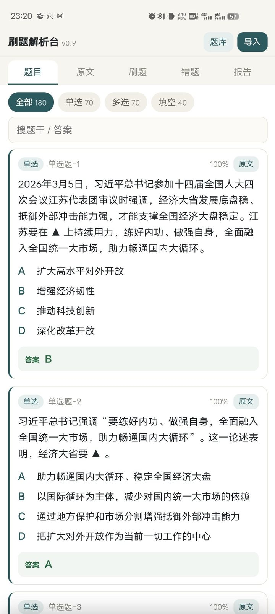
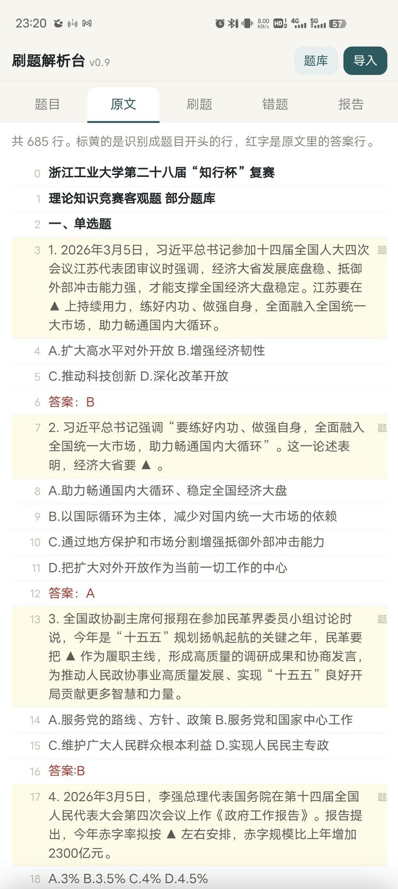
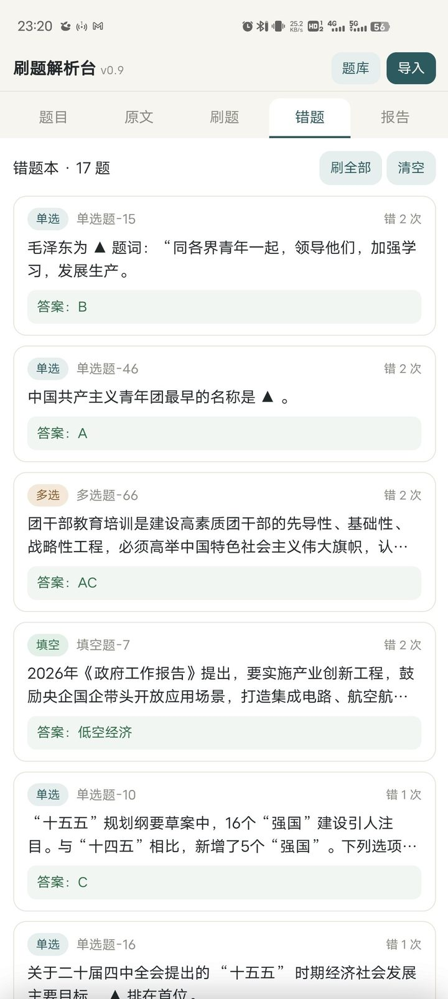
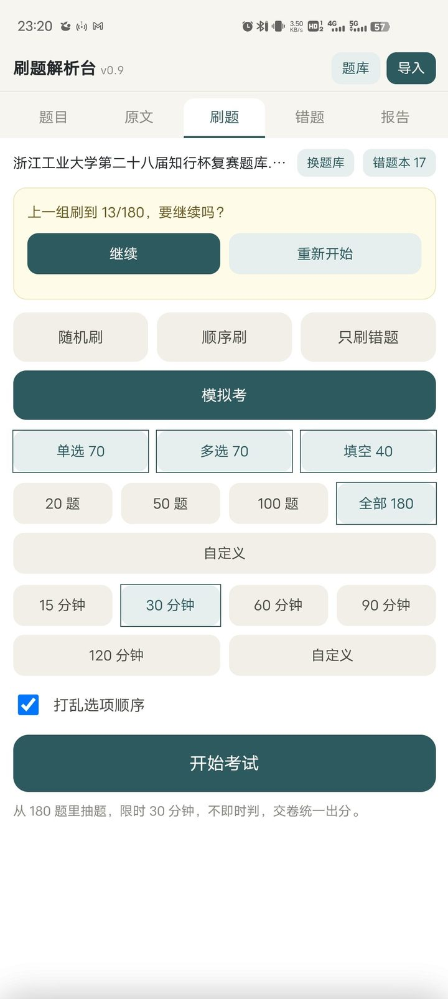
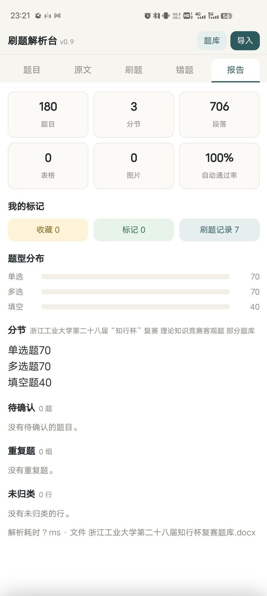
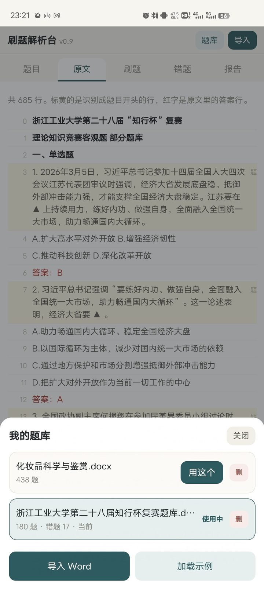

# 茶茶刷题（Chacha Quiz）

把一份 Word 题库，拆成能一道道刷的题。

学校竞赛那份题库是 Word 写的，685 行，选项挤在一行、答案印成红字、中间还夹着表格。现成的刷题 App 喂不进去，就自己写了解析器，又搭了个刷题界面。



180 道题丢进去，分出 180 道，自动通过率 100%，待确认 0 道，一道没手动改。

## 长什么样

| 原文对照 | 错题本 | 刷题与模拟考 |
| :---: | :---: | :---: |
|  |  |  |

| 刷题报告 | 题库管理 |
| :---: | :---: |
|  |  |

## 能干什么

- **解析台**：导入 `.docx`，分出题干、选项、答案和解析，结果可以导出 JSON
- **刷题**：随机、顺序、只刷错题，选项可以打乱，选完立刻判
- **模拟考**：从题库抽题，限时 15 到 120 分钟，交卷统一出分
- **错题本**：答错自动收进来，按错的次数排序，一键重刷
- **报告**：题目数、分节、段落、题型分布、待确认、重复题、自动通过率，一页看完
- **多题库**：本地存好几份，切换着用，进度和错题按题库分开算

## 怎么用

手机装 APK，在 Releases 下载 `茶茶刷题-v0.9.1.apk`，安卓 8.0 以上。不想装就浏览器打开 `quiz/dist/刷题解析台.html`，一个文件，断网也能用。

数据只存本机。网页版用 `localStorage`，App 里通过 JS 桥写进 `SharedPreferences`，不联网，不登录，不发请求。

## 目录

```
quiz/              解析台和刷题前端，HTML/JS，无构建、无依赖
  index.html       页面入口
  js/parse.js      docx 解析器，浏览器和 Node 都能跑
  js/quiz.js       刷题引擎：会话、判分、错题、模拟考、记录
  js/app.js        解析台界面和题库管理
  vendor/          JSZip（解 zip 用，单文件版会内嵌）
  samples/         dirty.docx，自造的脏格式样例
  test/            Node 测试和单文件打包脚本
  dist/            单文件版
quiz-app/          Android 壳，WebView 加手工打包脚本
  src/             MainActivity
  res/ art/        图标
  build.sh         打包脚本
docs/screenshots/  截图
```

## 构建

前端不用构建，起个静态服务器就能改：

```sh
cd quiz
python3 -m http.server 8100        # 浏览器打开 http://127.0.0.1:8100/
node test/build-single.js          # 重新打单文件版
node test/verify.js samples/dirty.docx
node test/parse-test.js samples/dirty.docx --all
```

打单文件版时默认内嵌 `samples/dirty.docx`。想换示例就 `node test/build-single.js 你的题库.docx`，不想内嵌就传一个不存在的路径。

APK 需要 Android SDK（build-tools 34 以上，platform 34 或 35）和 JDK 17 以上：

```sh
cd quiz-app && bash build.sh
```

脚本会自动找 SDK，找不到就用 `ANDROID_SDK` 指定；Windows 上在 Git Bash 里跑一样可以。

## 解析器能认什么

- 大节标题（`一、单选题`）、题号（`1.` / `1、` / `第1题` / Word 自动编号）
- 选项：`A.` / `A、` / `①` / 一行挤多个 / tab 分隔
- 答案：`答案：` / 红字 / 白字 / 隐藏字 / 文末答案清单 / 「题号|答案」表格
- 题干里的表格和图片，以及整张表格形式的题库
- 每道题带置信度和问题标签：无答案、选项不足、答案不在选项里、题号不连续、重复题

## 技术说明

- 解析器直接读 docx 里的 `word/document.xml`，不经过 HTML 中转。XML 解析、样式颜色编号、表格、图片、文本框都是自己实现的
- 判断答案优先看结构信号，段落样式、字符颜色、隐藏属性、`numbering.xml` 里的真实编号，字符串规则只做兜底；每条规则给置信度，低分题进「待确认」而不是硬猜
- 页面是单个 HTML，约 230KB，不带框架、不发网络请求
- APK 是 WebView 套这个单文件页面，不到 250KB

## 仓库里没有什么

- 不带真实题库。`samples/` 里只有自造的 `dirty.docx`，测试和截图用的题库不随仓库分发
- 不带安装包。APK 走 Releases，`.gitignore` 里已经排除了 `*.apk`

## 许可

MIT
